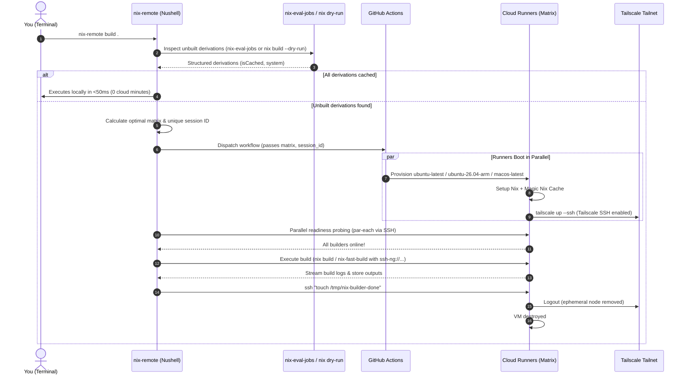

# Nix - Remote Builders Distributed

Nix's remote builders in a distributed manner, including a GitHub Reusable Workflow

## Overview

Compiling heavy Nix derivations (such as Linux kernels, WebKit, LLVM, or cross-compiled packages) can overwhelm your local machine, drain battery, and take hours. Traditional remote builders require dedicated servers running 24/7, accumulating steep infrastructure bills even while idle.

`nix-remote` dynamically offloads any `nix` command (`build`, `flake check`, `shell`, `develop`) to an on-demand cluster of cloud builders over Tailscale SSH with zero persistent server costs.

```sh
# Offload heavy builds to on-demand cloud runners in one command
nix-remote build .#myHeavyPackage

# Or execute ad-hoc without installing nix-remote
nix run github:Malix-Labs/Nix_Remote-Builders-Distributed -- build .#myHeavyPackage
```

### Features

- **Zero Idle Costs**: Runners spin up on your chosen cloud provider (GitHub Workflows) only when compilation is required and self-destruct as soon as the build finishes.
- **Instant Cache Bypass with `nix-eval-jobs`**: Automatically inspects derivations in `<50ms`. If everything is already cached upstream (e.g. `cache.nixos.org`), builds run locally with zero cloud provisioning delay.
- **Multi-Arch Matrix**: Automatically scales and allocates native `x86_64-linux`, `aarch64-linux`, and `aarch64-darwin` runners in parallel according to real unbuilt derivation requirements.
- **Direct WireGuard Tunneling (Tailscale SSH)**: End-to-end encrypted connection authenticated via secretless OIDC (Workload Identity Federation) or OAuth. No port forwarding, public IPs, or firewall holes needed.
- **Drop-in Nix Replacement**: Seamlessly prefix standard commands (`build`, `flake check`) or use `--fast` for pipelined builds with `nix-fast-build`.
- **Binary Cache Push**: Builders push the outputs they built to [Attic](https://github.com/zhaofengli/attic) or any `nix copy` store before they shut down.
- **Builder-Side Substitution**: Builders fetch dependencies from cache.nixos.org, your own caches and private Attic caches instead of receiving them from your machine.
- **Any Build Command**: `nix-remote exec -- nh os switch` wraps nh, nixos-rebuild, darwin-rebuild, home-manager or anything else that calls Nix. `nix-remote up` registers builders with the nix-daemon so that every build on the machine uses them.
- **Callable from Forgejo/Gitea**: A composite action runs the client inside a Forgejo Actions job, so an on-prem forge can build private flakes on these builders.

## Architecture



## Prerequisites

1. **Tailscale & Tailscale SSH**:
   * Set up Tailscale authentication in your runner repository (`<owner>/<repo>`). You can use any of the following methods:
     * **Method A: Workload Identity Federation / OIDC (Recommended, Secretless)**:
       Create a Trust Credential in [Tailscale Admin → Trust credentials](https://login.tailscale.com/admin/settings/trust-credentials) for GitHub Actions with `tag:nix-builder`. Store `TS_OAUTH_CLIENT_ID` and `TS_AUDIENCE`:
       ```sh
       gh secret set TS_OAUTH_CLIENT_ID --repo <owner>/<repo> --body "<your-client-id>"
       gh secret set TS_AUDIENCE --repo <owner>/<repo> --body "<your-audience>"
       ```
     * **Method B: OAuth Client Credentials**:
       Create an OAuth client in [Tailscale Admin → OAuth clients](https://login.tailscale.com/admin/settings/oauth-clients) with the `auth_keys` write scope and `tag:nix-builder`. Store `TS_OAUTH_CLIENT_ID` and `TS_OAUTH_SECRET`:
       ```sh
       gh secret set TS_OAUTH_CLIENT_ID --repo <owner>/<repo> --body "<your-client-id>"
       gh secret set TS_OAUTH_SECRET --repo <owner>/<repo> --body "<your-client-secret>"
       ```
     *(Note: Secrets can be added as Repository Secrets or scoped within a GitHub Actions Environment e.g. `--env "Nix Builders"`).*
   * Enable Tailscale SSH for `tag:nix-builder` in your [Tailscale ACL Policy](https://login.tailscale.com/admin/acls):
     ```json
     "ssh": [
       {
         "action": "accept",
         "src": ["autogroup:member"],
         "dst": ["tag:nix-builder"],
         "users": ["runner", "root", "autogroup:nonroot"]
       }
     ]
     ```
2. **GitHub CLI (`gh`)**:
   * Installed locally and authenticated (`gh auth login`).
3. **Nix with Flakes enabled**.

## Runner Setup (GitHub Workflow)

In your runner repository (where builds will execute via GitHub Workflows), copy the caller workflow template to `.github/workflows/nix-builder.yml`:

Template: [`examples/nix-builder.yml`](examples/nix-builder.yml)


> [!TIP]
> **Secret Scoping & Environment Fallback**:
> - If `environment: "Nix Builders"` is passed, GitHub Actions resolves secrets from that environment.
> - If `environment` is omitted or set to `""`, the reusable workflow safely evaluates `environment` to `null`. This prevents GitHub Actions from automatically creating empty environments in your repository when using repository-level secrets.
> - Passing timeouts with `format('{0}', inputs.timeout_*)` guarantees type compatibility across reusable workflow boundaries while preserving native numeric input fields in the GitHub Actions dispatch UI.

## Client Setup

### Flakes

1. Add input to `flake.nix`:
   ```nix
   inputs.nix-remote-builders = {
     url = "github:Malix-Labs/Nix_Remote-Builders-Distributed";
     inputs.nixpkgs.follows = "nixpkgs";
   };
   ```
2. Use as:
   - **Home Manager Module (Recommended)**:
     ```nix
     imports = [
       inputs.nix-remote-builders.homeManagerModules.default
     ];
     ```
   - **Package**:
     ```nix
     inputs.nix-remote-builders.packages.${pkgs.stdenv.hostPlatform.system}.default
     ```
   - **Imperative Profile**:
     - **`nix profile`**:
       ```sh
       nix profile install github:Malix-Labs/Nix_Remote-Builders-Distributed
       ```
     - **`nix-env` (legacy)**:
       ```sh
       nix-env -iE '(import <nixpkgs> {}).callPackage (fetchTarball "https://github.com/Malix-Labs/Nix_Remote-Builders-Distributed/archive/main.tar.gz") {}'
       ```
   - **Ephemeral Shell**:
     - **`nix shell`**:
       ```sh
       nix shell github:Malix-Labs/Nix_Remote-Builders-Distributed
       ```
     - **`nix-shell` (legacy)**:
       ```sh
       nix-shell -p '(import <nixpkgs> {}).callPackage (fetchTarball "https://github.com/Malix-Labs/Nix_Remote-Builders-Distributed/archive/main.tar.gz") {}'
       ```
   - **Ephemeral Run**:
     - **`nix run`**:
       ```sh
       nix run github:Malix-Labs/Nix_Remote-Builders-Distributed -- --repo <owner>/<repo> build .#target
       ```
     - **`nix-shell --run` (legacy)**:
       ```sh
       nix-shell -p '(import <nixpkgs> {}).callPackage (fetchTarball "https://github.com/Malix-Labs/Nix_Remote-Builders-Distributed/archive/main.tar.gz") {}' --run 'nix-remote --repo <owner>/<repo> build .#target'
       ```

### [`tack`](https://github.com/manic-systems/tack)

1. Add dependency:
   ```sh
   tack add nix-remote-builders https://github.com/Malix-Labs/Nix_Remote-Builders-Distributed
   ```
2. Use as:
   - **Home Manager Module (Recommended)**:
     ```nix
     imports = [
       (import (import ./.tack).nix-remote-builders { inherit pkgs; }).homeManagerModules.default
     ];
     ```
   - **Package**:
     ```nix
     import (import ./.tack).nix-remote-builders { inherit pkgs; }
     ```

### [`npins`](https://github.com/andir/npins)

1. Add dependency:
   ```sh
   npins add git https://github.com/Malix-Labs/Nix_Remote-Builders-Distributed -n nix-remote-builders
   ```
2. Use as:
   - **Home Manager Module (Recommended)**:
     ```nix
     imports = [
       (import (import ./npins).nix-remote-builders { inherit pkgs; }).homeManagerModules.default
     ];
     ```
   - **Package**:
     ```nix
     import (import ./npins).nix-remote-builders { inherit pkgs; }
     ```

### [`niv`](https://github.com/nmattia/niv)

1. Add dependency:
   ```sh
   niv add Malix-Labs/Nix_Remote-Builders-Distributed -n nix-remote-builders
   ```
2. Use as:
   - **Home Manager Module (Recommended)**:
     ```nix
     imports = [
       (import (import ./nix/sources.nix).nix-remote-builders { inherit pkgs; }).homeManagerModules.default
     ];
     ```
   - **Package**:
     ```nix
     import (import ./nix/sources.nix).nix-remote-builders { inherit pkgs; }
     ```

### `builtins.fetchGit`

- **Home Manager Module (Recommended)**:
  ```nix
  imports = [
    (import (builtins.fetchGit {
      url = "https://github.com/Malix-Labs/Nix_Remote-Builders-Distributed.git";
      rev = "<COMMIT_HASH>";
    }) { inherit pkgs; }).homeManagerModules.default
  ];
  ```
- **Package**:
  ```nix
  import (builtins.fetchGit {
    url = "https://github.com/Malix-Labs/Nix_Remote-Builders-Distributed.git";
    rev = "<COMMIT_HASH>";
  }) { inherit pkgs; }
  ```

### `builtins.getFlake`

- **Home Manager Module (Recommended)**:
  ```nix
  imports = [
    (builtins.getFlake "github:Malix-Labs/Nix_Remote-Builders-Distributed/<REV_OR_TAG>").homeManagerModules.default
  ];
  ```
- **Package**:
  ```nix
  (builtins.getFlake "github:Malix-Labs/Nix_Remote-Builders-Distributed/<REV_OR_TAG>").packages.${pkgs.stdenv.hostPlatform.system}.default
  ```

### Configuration

#### Home Manager:
Configure your target runner repository and options in your Home Manager configuration:
```nix
programs.nix-remote = {
  enable = true;
  settings = {
    repo = "<owner>/<repo>"; # Target repository hosting your .github/workflows/nix-builder.yml
    environment = "<env-name>"; # Optional: custom GitHub Actions environment containing secrets
    tailscale_tags = "tag:nix-builder"; # Optional: custom Tailscale ACL tags
  };
};
```

#### Standalone / Manual:
Configure `~/.config/nix-remote/config.toml`:
```toml
repo = "<owner>/<repo>"
environment = "<env-name>" # Optional: custom GitHub Actions environment containing secrets
tailscale_tags = "tag:nix-builder" # Optional: custom Tailscale ACL tags
```

## Usage & Examples

```sh
# Auto-scales runners based on unbuilt derivations detected by nix-eval-jobs
nix-remote build .#myHeavyPackage

# Pass 'nix' prefix optionally (both 'nix-remote build' and 'nix-remote nix build' work)
nix-remote nix build .#myHeavyPackage

# Pass Nix-specific flags (e.g. -L, --print-out-paths) using the '--' separator
nix-remote -- build -L --print-out-paths .#myHeavyPackage

# Run flake checks across remote runners using nix-fast-build
nix-remote flake check

# Explicitly allocate 4 x86_64 and 2 aarch64 runners
nix-remote --x86 4 --arm 2 build .#multiArchTarget

# Keep runners alive for 10 minutes (600s linger) for subsequent builds
nix-remote --timeout-linger 600 -- build -L .#part1

# Override repository without editing config.toml
nix-remote --repo <owner>/<repo> build .#target
```

## System Rebuilds & Machine-Wide Sessions

### `nix-remote exec`: wrap any command

```sh
nix-remote exec -- nh os switch .
nix-remote exec -- nh os switch . -H terra --target-host terra
nix-remote exec -- nixos-rebuild switch --flake .#lapwolf --sudo
nix-remote exec -- darwin-rebuild switch --flake .#rotna
nix-remote exec -- nh home switch .
nix-remote exec --x86 2 -- deploy .#icicle          # anything else: give counts or --for
nix-remote exec --for .#packages.x86_64-linux.big -- ./my-script
```

For `nh os|home|darwin`, `nixos-rebuild`, `darwin-rebuild` and `home-manager`,
`exec` works out which output the command builds. It reads `--flake`, `-H`,
`-c`, `NH_FLAKE`, `NH_OS_FLAKE` and similar, and falls back to this machine's
hostname. It then dry-runs that output: if everything is cached, the command
runs immediately without builders. Otherwise builders are sized from the
systems of the derivations that need building (`i686-linux` goes to x86
builders). Commands it does not recognise get one builder of this machine's
system unless `--for` or explicit counts are given. When the command exits, the
builders shut down and its exit code is returned.

The builders reach the command through `NIX_CONFIG` (`builders`,
`builders-use-substitutes`, `max-jobs = --local-jobs`), which the nix-daemon
honours for trusted users. With the system module below, `exec` also registers
the session with the daemon, so builds started by root or other users use the
builders too (for example `sudo nixos-rebuild`).

### `nix-remote up` / `down` / `status`: machine-wide sessions

```sh
nix-remote up --x86 2 --arm 1          # or --for <installable> to size it
nh os switch .                         # plain commands now use the builders
nixos-rebuild boot --flake .#terra --target-host terra
nix-remote status                      # list sessions, drop unreachable builders
nix-remote down                        # stop all sessions (or: down <session>)
```

`up` writes the builders to a machines file that the nix-daemon's `builders`
setting includes. Nix reads it at the start of each build, so nothing needs
restarting. Builders shut down after `--timeout-idle` (default 900 s) without
builds, or with `down`.

### NixOS / nix-darwin module

```nix
imports = [ inputs.nix-remote-builders.nixosModules.default ];   # or darwinModules.default
services.nix-remote = {
  enable = true;
  users = [ "alice" ];                 # NixOS: may start/stop sessions
  settings.repo = "<owner>/<runner-repo>";
};
```

The module installs `nix-remote` and sets
`nix.settings.builders = "@/etc/nix/machines;@<machinesFile>"`, so
`nix.buildMachines` keep working next to session builders. It also enables
`builders-use-substitutes` and creates the shared state directory:
`/run/nix-remote` on NixOS with group `nix-remote`, or `/var/lib/nix-remote`
on macOS with group `admin`. `settings` becomes `/etc/nix-remote/config.toml`,
which each user's `~/.config/nix-remote/config.toml` overrides.

The SSH connections to builders are made by the nix-daemon, usually as root.
Builder host keys are pinned in the machines file. Root must still resolve
`nix-builder-*` through MagicDNS, and the host must be allowed in the
Tailscale SSH policy (`src` must cover the host's tag or owner).

## CLI Options (`nix-remote`)

```text
Distribute Nix builds across on-demand cloud runners over Tailscale SSH.

Usage:
  > nix-remote {flags} ...(rest) 

Flags:
  -h, --help: Display the help message for this command
  --provider <string>: Cloud provider backend (default: 'gha')
  --fast: Use nix-fast-build for pipelined eval + remote builds
  --built-in: Force standard nix CLI executor
  --max-runners <int>: Maximum auto-scaled runners (default: 4)
  --runners <int>: Force an exact total number of runners
  --x86 <int>: Force an exact x86_64-linux runner count
  --arm <int>: Force an exact aarch64-linux runner count
  --darwin <int>: Force an exact aarch64-darwin runner count
  --local-jobs <int>: Local Nix jobs limit (0 offloads all builds to remote) (default: 0)
  --timeout-startup <int>: Seconds to wait for initial runner connection (default: 300)
  --timeout-idle <int>: Seconds of inactivity before runner disconnects (default: 300)
  --timeout-linger <int>: Seconds to keep runner alive after build completion (default: 0)
  --repo <string>: Target repository hosting the runner workflow (owner/repo)
  --environment <string>: GitHub Actions environment name containing secrets
  --tailscale-tags <string>: Tailscale ACL tags to apply to runner nodes
  --keep-alive: Keep runners alive after command finishes
  --no-builder-substitutes: Copy every input from this machine instead of letting builders use their substituters

Parameters:
  ...rest <string>: Nix command and arguments (e.g. build .#default)

Subcommands:
  nix-remote exec - Run any command (nh, nixos-rebuild, darwin-rebuild, home-manager, ...) with remote builders.
  nix-remote up - Start builders and register them with the nix-daemon until `nix-remote down`.
  nix-remote down - Stop builder sessions and remove them from the machines file.
  nix-remote status - Show builder sessions, dropping builders that are no longer reachable.
```

## Binary Caches & Substitution

### Substitution on builders

`nix-remote` sets `builders-use-substitutes = true`, so a builder downloads
missing inputs from its own substituters instead of receiving them from your
machine over SSH. Pass `--no-builder-substitutes` to turn this off.

Each builder trusts `cache.nixos.org`, the GitHub Actions cache (Magic Nix
Cache, `magic_nix_cache: "false"` to disable) and whatever the caller workflow
adds:

| Input | Description |
| :--- | :--- |
| `substituters` / `trusted_public_keys` | Space-separated extra substituters and their keys. |
| `extra_nix_conf` | Extra lines for the builders' `nix.conf`. |
| `attic_server` + `attic_cache` | Adds the Attic cache as a substituter (`attic_substitute: "false"` to skip). Its substituter URL and public key are read from the server's `/_api/v1/cache-config/<cache>` unless `attic_substituter` and `attic_public_key` are set. |
| `secrets.ATTIC_TOKEN` | Written to the builders' netrc so private Attic caches can be read. |
| `secrets.NIX_NETRC` | netrc contents for any other authenticated substituter. |

The substituter configuration is resolved before the builder joins the tailnet.
For a tailnet-only Attic server, set `attic_substituter` and `attic_public_key`
explicitly so that no API call is needed at that point.

### Pushing built outputs

When a session ends, each builder lists the store paths added since it started
and pushes them before shutting down:

- `push_paths: built` (default) pushes the outputs this builder built itself
  (Nix marks them `ultimate`), together with their closures. Inputs that were
  substituted or copied from the client are not pushed on their own.
- `push_paths: all` pushes every path added during the session.

| Target | Inputs |
| :--- | :--- |
| Attic | `attic_server`, `attic_cache`, `secrets.ATTIC_TOKEN` (push permission). `attic_push: "false"` to only substitute. Attic skips paths already signed by its upstream caches. |
| Any Nix store | `push_to`, e.g. `s3://bucket?region=eu-west-1`, `file:///…`, `ssh-ng://cache-host`. `secrets.NIX_SIGNING_KEY` signs the paths first. `secrets.AWS_ACCESS_KEY_ID`/`AWS_SECRET_ACCESS_KEY` for S3. |

#### Backblaze B2

Attic stores its chunks in S3-compatible object storage, so the usual route is
Attic with B2 as its `[storage]` backend (`type = "s3"`, `endpoint =
"https://s3.<region>.backblazeb2.com"`). Builders push to Attic, and Attic
handles signing, deduplication and B2. Attic clients cannot write to the bucket
directly.

To skip Attic, push a plain Nix binary cache straight to B2 through its S3 API:

```yaml
push_to: "s3://<bucket>?endpoint=s3.<region>.backblazeb2.com&region=<region>&compression=zstd"
secrets:
  AWS_ACCESS_KEY_ID: ${{ secrets.B2_KEY_ID }}          # B2 application key ID
  AWS_SECRET_ACCESS_KEY: ${{ secrets.B2_APPLICATION_KEY }}
  NIX_SIGNING_KEY: ${{ secrets.NIX_SIGNING_KEY }}      # `nix key generate-secret`
```

Without Attic there is no chunk deduplication or garbage collection. Every
closure path that the bucket lacks is uploaded, including ones on
cache.nixos.org.

The log reports path counts only; per-path output is shown only if a push
fails. Pushes happen after the client has disconnected, so the cache fills a
few seconds after `nix-remote` returns. The example
[`examples/nix-builder.yml`](examples/nix-builder.yml) maps these inputs to
repository variables (`ATTIC_ENDPOINT`, `ATTIC_CACHE`, …) and secrets.

## Public Runner Repositories

GitHub Actions minutes are free for public repositories, so the runner
repository can be public. Builders receive derivations only over Tailscale
SSH, never through the repository. Runs, job names and logs are public,
though. The template and client keep metadata out of them:

| What | How |
| :--- | :--- |
| Command being built | Not sent: `target` stays empty and the run name is `nix-remote [<random session id>]`. Set `show_target = true` in `config.toml` to send it. |
| Cache URLs, keys, Attic endpoint and cache name | `::add-mask::` before any other step, so the Nix installer and later steps print `***`. |
| Store paths | Pushes log counts only. Per-path output needs `verbose_logs: "true"`. |
| Build outputs in the Actions cache | `magic_nix_cache: "false"`: workflows from fork pull requests can read a public repository's caches. |
| Run history and logs | `delete_runs = true` in `config.toml`: a detached process deletes the session's run once it completes. `purge_runs: "true"` also deletes earlier completed runs when a session starts, as a backstop. Set log retention to 1 day. |

Still visible while a run exists: that a run happened, its duration, the
builder job names (`x86-0`, `darwin-0`), runner images, and the tailnet tag
and random builder hostnames in the Tailscale step. Secrets are never exposed
to fork pull requests. Also require approval for outside contributors'
workflows (Settings → Actions → General).

## Calling from Forgejo / Gitea

GitHub cannot run a Forgejo workflow, and the builders should not need
credentials for your forge. Instead the **client** runs in your Forgejo job:

1. The Forgejo runner checks out and evaluates the flake. Private inputs are
   fetched on-premises with the forge's own credentials.
2. It dispatches the builder workflow in your GitHub runner repository and
   joins the tailnet.
3. GitHub builders receive only the derivations and sources they need, over
   Tailscale SSH. They build, send the outputs back, and push them to your cache.

```yaml
# .forgejo/workflows/nix-remote.yml
- uses: https://github.com/dweee/Nix_Remote-Builders-Distributed@main
  with:
    repo: <owner>/<runner-repo>                     # GitHub repository with nix-builder.yml
    github-token: ${{ secrets.NIX_REMOTE_GITHUB_TOKEN }}
    tailscale-authkey: ${{ secrets.TS_AUTHKEY }}    # omit if the runner host is on the tailnet
    tailscale-tags: tag:nix-remote-client
    args: -- build -L .#default
```

Full example: [`examples/forgejo/nix-remote.yml`](examples/forgejo/nix-remote.yml).

| Input | Description |
| :--- | :--- |
| `args` | `nix-remote` arguments, word-split like a shell (e.g. `--x86 2 -- build .#a .#b`). |
| `repo` | GitHub runner repository (`owner/repo`). |
| `github-token` | Fine-grained GitHub PAT with **Actions: read and write** on `repo`. |
| `environment` | GitHub Actions environment holding the builder secrets. |
| `builder-tags` | Tailscale tags for the builders (default `tag:nix-builder`). |
| `tailscale-authkey` | Auth key or OAuth client secret. Starts a userspace `tailscaled` that needs neither root nor `/dev/net/tun`; OAuth secrets become ephemeral, pre-authorized nodes. |
| `tailscale-tags` / `tailscale-hostname` | Tags (required with an OAuth secret) and hostname for the runner node. |

Requirements and caveats:

- `nix` must already be on the runner's `PATH` with flakes available. The
  action builds `nix-remote`, `gh`, `ssh`, `jq` and `tailscale` from its own
  flake lock.
- Builds go through remote builders, so the user running Nix must be allowed to
  set `builders` (a trusted user, root, or a single-user install).
- The SSH connections are made by whoever runs the build. In a single-user or
  root container that is the job itself. With a multi-user daemon it is the
  daemon's user (usually root), which needs tailnet access and MagicDNS.
  Builder host keys are pinned in the builder spec, so its `known_hosts` does
  not matter. Without a TUN device (userspace `tailscaled`), the action
  routes `nix-builder-*` through `tailscale nc` in `~/.ssh/config`. A daemon
  running as a different user does not read that file.
- Allow the runner's tag in the Tailscale SSH policy:
  ```json
  { "action": "accept", "src": ["tag:nix-remote-client"], "dst": ["tag:nix-builder"], "users": ["runner"] }
  ```
  When tagging the runner, it also needs `"tagOwners": { "tag:nix-remote-client": [...] }`.
- Keep the GitHub runner repository **private**. Builders receive your
  derivations' sources, and the cache push runs there.

## Runner Lifecycle & Watchdog

Each provisioned cloud runner runs a resilient background watchdog script that governs its lifecycle, idle teardown, and self-destruction:

| Lifecycle Phase | Parameter / Signal | Default | Description |
| :--- | :--- | :--- | :--- |
| **Startup Wait** | `timeout_startup` / `--timeout-startup` | `300s` | Runner waits for the local client to establish its first SSH connection. Auto-cancels if client never connects. Set `0` to disable. |
| **Idle Monitor** | `timeout_idle` / `--timeout-idle` | `300s` | Tracks active SSH connections (`ss` / `lsof`) and `nix-daemon` activity. When connections drop to zero and remain idle past this threshold, the runner safely terminates. Set `0` to disable idle teardown. |
| **Completion Signal** | `/tmp/nix-builder-done` | - | `nix-remote` sends `ssh runner@<host> touch /tmp/nix-builder-done` as soon as the build finishes (unless `--keep-alive` is set). |
| **Post-Build Linger**| `timeout_linger` / `--timeout-linger` | `0s` | Once `/tmp/nix-builder-done` is signaled, the runner remains alive for this extra duration before shutting down (useful for running rapid successive builds on a warm runner). |

After the watchdog exits, the builder pushes to the configured binary caches (see [Pushing built outputs](#pushing-built-outputs)). Then the runner triggers post-run cleanup where `tailscale/github-action` logs out (promptly removing the ephemeral node from your Tailnet) and the GitHub Actions VM terminates.
